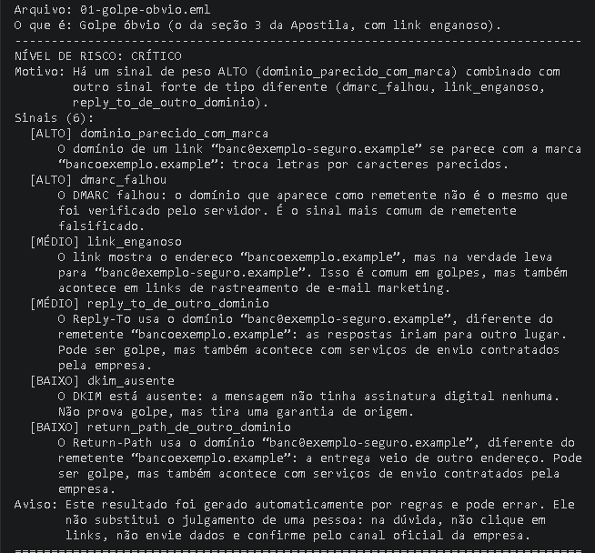

# Anzol 🎣

> 🚧 **Projeto em construção.**

O **Anzol** é uma API feita em [FastAPI](https://fastapi.tiangolo.com/) para analisar
e-mails e URLs suspeitos de *phishing*. Para cada análise, a API vai devolver:

- **nível de risco**: BAIXO, MÉDIO, ALTO ou CRÍTICO;
- **sinais encontrados**: os indícios que levaram à classificação;
- **parecer**: uma explicação em português do Brasil.

## Como rodar localmente

```bash
python -m venv .venv
# Windows: .venv\Scripts\activate   |   Linux/macOS: source .venv/bin/activate
pip install -r requirements.txt
uvicorn app.main:app --reload
```

Depois acesse <http://127.0.0.1:8000/saude> ou a documentação em <http://127.0.0.1:8000/docs>.

## Demonstração

A pasta [exemplos/](exemplos/) tem 4 e-mails **fictícios** (domínios `.example`), e o
script [scripts/testar.py](scripts/testar.py) envia cada um ao Anzol e mostra o resultado.

| Exemplo | O que mostra | Resultado |
|---|---|---|
| `01-golpe-obvio.eml` | Golpe da seção 3 da Apostila, com link enganoso | CRÍTICO ✅ |
| `02-legitimo.eml` | E-mail legítimo do banco fictício | BAIXO ✅ |
| `03-golpe-bem-feito.eml` | Golpe com domínio próprio e SPF/DKIM/DMARC corretos | BAIXO ❌ (limitação: só as regras não o pegam) |
| `04-lista-de-discussao.eml` | E-mail legítimo que passou por uma lista de discussão | CRÍTICO ❌ (falso positivo: a lista quebra DKIM e DMARC) |



*O Anzol analisando o e-mail fictício de golpe (`01-golpe-obvio.eml`): nível CRÍTICO, 6 sinais, cada um explicado.*

Os dois ❌ estão lá de propósito: mostram o que as regras sozinhas ainda erram.
O teste [tests/test_exemplos.py](tests/test_exemplos.py) garante que esta tabela continua verdadeira.

**No Windows (PowerShell), dentro da pasta do projeto:**

1. Instale as dependências (só na primeira vez):
   ```powershell
   python -m venv .venv
   .venv\Scripts\python -m pip install -r requirements.txt
   ```
2. Suba o servidor e **deixe essa janela aberta**:
   ```powershell
   .venv\Scripts\python -m uvicorn app.main:app
   ```
   Ele está pronto quando aparecer `Uvicorn running on http://127.0.0.1:8000`.
3. Abra **outra** janela do PowerShell, entre na pasta do projeto e rode:
   ```powershell
   .venv\Scripts\python scripts\testar.py
   ```
   Para testar um arquivo só: `.venv\Scripts\python scripts\testar.py exemplos\02-legitimo.eml`
4. Para desligar o servidor, volte à primeira janela e aperte `Ctrl+C`.

Também dá para testar pelo navegador em <http://127.0.0.1:8000/docs>.

## Como analisar um e-mail

Copie o e-mail completo, com cabeçalhos (no seu programa de e-mail, em geral pela
opção "Mostrar original" ou "Ver código-fonte"), salve como `email.eml` e envie:

```bash
curl -X POST http://127.0.0.1:8000/analisar      -H "Content-Type: text/plain; charset=utf-8"      --data-binary @email.eml
```

Resposta (exemplo com o e-mail fictício da Apostila):

```json
{
  "nivel": "CRÍTICO",
  "motivo": "Há um sinal de peso ALTO (dmarc_falhou) combinado com outro sinal forte de tipo diferente (reply_to_de_outro_dominio).",
  "sinais": [
    {"nome": "dmarc_falhou", "descricao": "O DMARC falhou: ...", "peso": "ALTO", "ocorrencias": 1}
  ],
  "aviso": "Este resultado foi gerado automaticamente por regras e pode errar. ..."
}
```

Regras da entrada: até **1 MB** (acima disso, erro 413), texto em UTF-8, com
`Content-Type` `text/plain` ou `message/rfc822` (outros tipos: erro 415), e com o
cabeçalho `From` (sem ele, ou com entrada vazia: erro 422).

**Privacidade (LGPD):** o conteúdo do e-mail não é guardado nem escrito em log.
Os logs registram só o tamanho, o nível e a quantidade de sinais. Nenhum link é
aberto e nada é consultado na internet.

## Como o nível de risco é calculado

Cada sinal tem um peso (BAIXO, MÉDIO ou ALTO). Cada **tipo** de sinal conta uma vez
só, com o maior peso que apareceu: dez links enganosos valem um sinal de link enganoso.

| Situação | Nível |
|---|---|
| Nenhum sinal | BAIXO |
| Só sinais BAIXO, de menos de 3 tipos diferentes | BAIXO |
| Só sinais BAIXO, de 3 ou mais tipos diferentes | MÉDIO |
| Algum sinal MÉDIO (e nenhum ALTO) | MÉDIO |
| Um sinal ALTO, sem outro MÉDIO ou ALTO de tipo diferente | ALTO |
| Um sinal ALTO **mais** outro sinal ALTO ou MÉDIO de tipo diferente | CRÍTICO |

Nenhum resultado "bom" (como `spf=pass`) reduz o risco: acrescentar sinais nunca
baixa o nível. As constantes ficam em [app/risco.py](app/risco.py).

| Sinal | Peso |
|---|---|
| `dmarc_falhou` | ALTO |
| `nome_de_marca_com_dominio_estranho` | ALTO |
| `dominio_parecido_com_marca` (letras trocadas, letra a mais/a menos) | ALTO |
| `dominio_parecido_com_marca` (marca dentro de outro domínio) | MÉDIO |
| `link_enganoso` | MÉDIO |
| `spf_falhou`, `dkim_falhou` | MÉDIO |
| `reply_to_de_outro_dominio` | MÉDIO |
| `dominio_punycode` | MÉDIO |
| `return_path_de_outro_dominio` | BAIXO |
| `spf_softfail`, `dkim_ausente` | BAIXO |

## Testes e qualidade

```bash
pytest
ruff check .
```

## Limitações conhecidas

- **Authentication-Results falso.** O Anzol só usa o `Authentication-Results`
  mais acima, que é o do servidor que recebeu a mensagem; os de baixo são
  ignorados, porque um golpista pode escrevê-los dentro do e-mail. Mesmo o de
  cima só é confiável se o e-mail foi copiado direto da caixa postal: quem
  monta o e-mail à mão pode colocar um cabeçalho falso no topo. Por isso um
  `pass` nunca reduz o risco nem apaga outros sinais.
- **Sem Authentication-Results, sem sinal de autenticação.** E-mails colados à
  mão podem não ter esse cabeçalho, e a ausência não é punida.
- **From duplicado.** Se houver mais de um `From`, vale o primeiro. (Reply-To e
  Return-Path repetidos são todos conferidos.)
- **Ainda sem IA.** Urgência, ameaças e pedidos de dados no texto ainda não são
  avaliados; o resultado depende só das regras acima.
- **Só links do HTML.** Endereços escritos no corpo em texto simples, em imagens
  ou em anexos ainda não são analisados.
- **Domínios parecidos só no From e nos links.** Reply-To e Return-Path são
  comparados com o From, mas não com a lista de marcas.
- **Nada é consultado na internet.** O Anzol não abre links nem consulta DNS;
  a análise é só do texto.

## Licença

Distribuído sob a licença MIT. Veja o arquivo [LICENSE](LICENSE).
